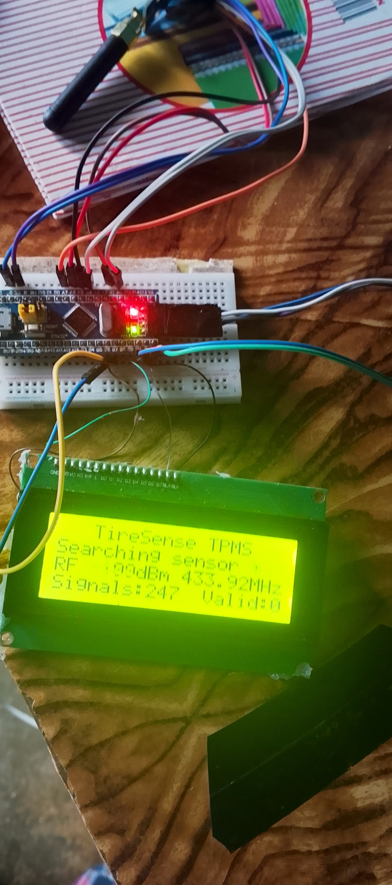
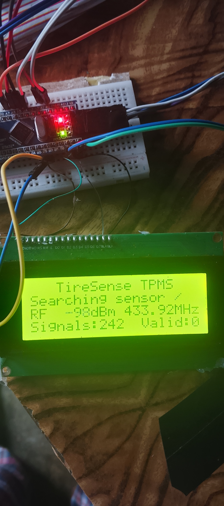
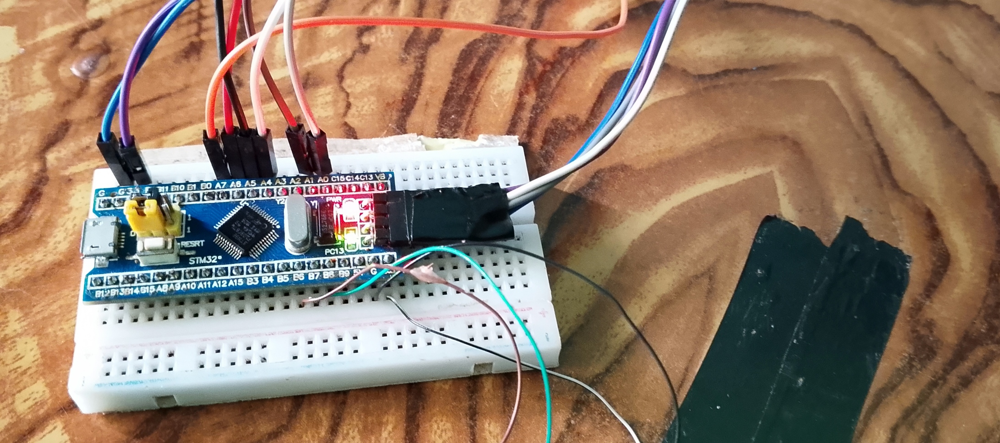
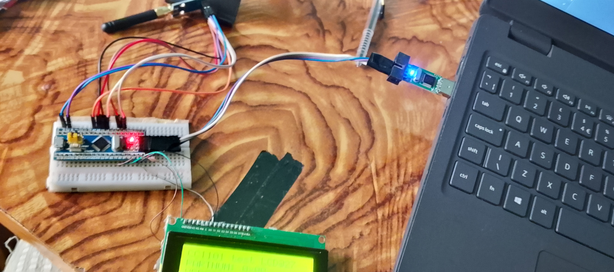
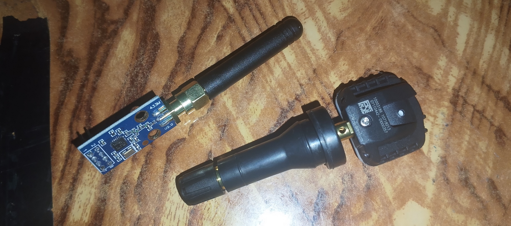

# TireSense TPMS — 433 MHz Tyre Pressure Monitor

STM32F103 (Blue Pill) + CC1101 receiver + 20x4 I2C LCD that receives wireless
tyre-pressure (TPMS) sensors and shows pressure, temperature, signal strength
and sensor ID.

## Screens
```
+--------------------+     +--------------------+     +--------------------+
|   TireSense TPMS   |     |   TireSense TPMS   |     | !! LOW PRESSURE !! |
|Searching sensor -  |     |P:2.31bar  33.5psi  |     |P:1.73bar  25.1psi  |
|RF -101dBm 433.92MHz|     |T:27C  RF:-47dBm    |     |T:30C  RF:-47dBm    |
|Signals:0    Valid:0|     |ID:1A2B3C4D  12s ago|     |ID:1A2B3C4D  0s ago |
+--------------------+     +--------------------+     +--------------------+
   no sensor yet               normal reading            alert (flashes)
```



Alerts: below 1.80 bar or above 3.50 bar (edit `LOW_PRESSURE_KPA` / `HIGH_PRESSURE_KPA`
in `Core/Src/app.c`). The LED blinks fast during an alert. Several sensors are
shown in rotation (up to 4).

## Wiring
| CC1101 | Blue Pill | | LCD backpack | Blue Pill |
|---|---|---|---|---|
| VCC | 3.3V (never 5 V) | | VCC | 5V |
| GND | GND | | GND | GND |
| SCK | PA5 | | SDA | PB7 |
| MISO | PA6 | | SCL | PB6 |
| MOSI | PA7 | | | |
| CSN | PA4 | | | |
| GDO0 | PA0 | | | |
| GDO2 | PA1 | | | |

Power the board from its micro-USB port (the LCD needs 5 V).

## Supported sensor formats
433.92 MHz FSK, Manchester, ~9.6 kbit/s family (preamble `55 55 55 56`):

| Name on log | Typical vehicles | Integrity check |
|---|---|---|
| VDO-HK | Hyundai / Kia (Continental TG1C-type) | CRC-8 |
| VDO-PSA | Citroën / Peugeot / Mitsubishi | XOR |
| VDO-TG1C | Fiat / Abarth / Mazda | XOR + range |
| Renault | Renault / Dacia | CRC-8 |
| Ford | Ford (Continental) | sum + flags |

Frame layouts follow the public documentation of the rtl_433 project
(github.com/merbanan/rtl_433); the decoder here is an independent
implementation for microcontrollers.

**Important:** a reading is shown only after a sensor's ID has been received
with a valid checksum **twice**. Sensors whose format is not in the table above
are detected ("Signals" count rises) but no values are shown. This firmware has
been verified in simulation (see `tests/`), not yet against a live sensor.

## How it works
1. **TIM3** samples the CC1101 RSSI every 250 µs and tracks the noise floor.
   RSSI > floor + 15 dB = a transmission is starting.
2. **TIM2 input capture** on GDO0 timestamps every edge of the demodulated data
   (1 µs resolution), only while a transmission is active.
3. **Decoder** (`Core/Src/tpms_decode.c`): finds the preamble, recovers the
   sensor's bit clock with a least-squares fit (tolerates ±15% data-rate error
   and timing jitter), Manchester-decodes, and checks each format's checksum.
4. **App** (`Core/Src/app.c`): confirms sensors, drives LCD / LED / USB log.

## USB serial log (any terminal, any baud rate)
```
# NEW SENSOR id=1A2B3C4D (VDO-HK)
T id=1A2B3C4D proto=VDO-HK P=231.0kPa 2.31bar 33.5psi T=27C rssi=-47 OK
S t=60s rf=-101dBm noise=-101 signals=3 valid=4 sensors=1 lost=0
```
Keys: `v` raw pulse dump, `r` RSSI stream, `+`/`-` trigger level,
`f`/`o` FSK/OOK, `c` clear, `?` help.

## Tests (run on a PC)
`tests/run_tests.sh` — simulated sensor transmissions for every format with
timing jitter, clock error and partial preambles (≥99% decoded, 0 wrong
readings); 40 million pulses of random noise (0 false readings); and the full
application running against simulated hardware, printing the LCD screens.

## Files
| File | Role |
|---|---|
| `Core/Src/cc1101.c` | CC1101 SPI driver, 433.92 MHz receive configuration |
| `Core/Src/rf_capture.c` | Interrupts: transmission detection + edge timing |
| `Core/Src/tpms_decode.c` | Multi-format TPMS decoder |
| `Core/Src/app.c` | Sensor table, LCD screens, alerts, USB log |
| `Core/Src/lcd_i2c.c` | HD44780 20x4 LCD over PCF8574 I2C |
| `USB_DEVICE/`, `Middlewares/` | USB virtual COM port (ST library) |
| `prebuilt/Wireless_pressure_sensor.hex` | Ready-to-flash firmware |

### The one short coming of this project is that i could not wake the TPMS sensor so i could not verify wheter it was working.




